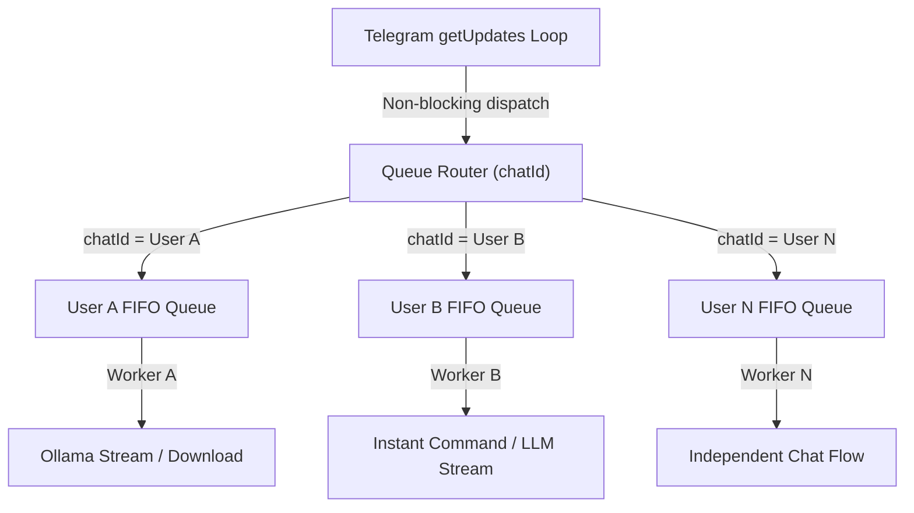

# NullPointer — Architecture & Invariants Guide

This skill guides agents and LLMs on maintaining the architectural integrity of **NullPointer**.

---

## 🏛️ Layer Boundaries & Dependency Rules

1. **`src/config/`**:
   - Only place where `process.env` is accessed and parsed using `zod`.
   - Exports `env`, `getConfig(key)`, and strongly-typed getters (`getConfigTelegramToken()`, `getConfigOllamaHost()`, etc.).
   - No other file is permitted to call `process.env`.

2. **`src/prompts/`**:
   - Dedicated home for all prompt engineering, system instructions, personas, and dynamic context builders.
   - `prompt.constants.ts`: Global bot name and creator metadata.
   - `persona.prompt.ts`: Foundational persona prompt and identity attribution.
   - `downloader.prompt.ts`: yt-dlp trigger directives, formatting rules, and few-shot examples.
   - `identity.prompt.ts`: User identity guidelines and dynamic user context prompt builder (`buildUserContextPrompt`).
   - `system.prompt.ts`: Full system prompt composer (`buildDefaultSystemPrompt`, `buildFullSystemPrompt`).
   - `index.ts`: Central barrel export for `@/prompts`.
   - No prompts or instructions may be hardcoded outside this module.

3. **`src/core/`**:
   - `logger/`: `ILogger` interface and `ConsoleLogger`.
   - `queue/`: `KeyedAsyncQueue` (per-chat FIFO asynchronous execution & cross-chat concurrency).
   - `errors/`: `AppError`, `TelegramApiError`, `LlmProviderError`, `UnauthorizedError`.
   - `types/`: Universal interfaces (`IDisposable`, `LogLevel`).

4. **`src/domain/`**:
   - `downloader/`: `IDownloaderService` interface, types, and `YtDlpDownloader` (resolves platform binaries, metadata, tubesnag cascades).
   - `llm/`: `ILlmProvider` interface (decouples LLM inference from Telegram).
   - `session/`: `ISessionStore` interface (abstracts conversation history storage).
   - `telegram/`: `ITelegramClient` and `TelegramClient` wrapper for Telegram Bot API.

5. **`src/services/`**:
   - `commands/`: Individual command classes implementing `ICommandHandler`.
   - `command.registry.ts`: Dispatches commands and builds `BotCommand[]` for Telegram autocomplete.
   - `downloader/`: `downloader-ui.helper.ts` (2-step hierarchical drilldown menus and active session cache).
   - `file-server/`: `IFileServerService` interface and `FileServerService` (HTTP server providing HTML5 web player streaming, HTTP 206 range requests, and direct downloads).
   - `bot.service.ts`: Update loop, typing indicator, throttled streaming, rate limit backoff, link detection, and delivery routing.

6. **`src/views/`**:
   - Server-Side Rendered (SSR) Preact TSX presentation components (`layouts/`, `components/`, `player.view.tsx`, `error.view.tsx`).

7. **`src/index.ts`**:
   - Pure Composition Root / Dependency Injection. Wires components together and handles OS signals (`SIGINT`, `SIGTERM`).

---

## 🚨 Critical Invariants Checklist

When editing or generating code in this repository:
- [ ] **No `process.env`**: Always import `getConfig...` from `@/config`.
- [ ] **No `.js` extensions**: Do not write `.js` in TypeScript imports.
- [ ] **Use `@/*` aliases**: Always use `@/core/...`, `@/domain/...`, `@/services/...`, `@/utils/...`, `@/prompts/...`.
- [ ] **Zero hardcoded prompts**: System prompts, personas, and LLM directives live exclusively in `@/prompts`.
- [ ] **Media Delivery Invariant**: ALL video downloads are hosted through the built-in HTTP File Server and NEVER uploaded to Telegram chat. Audios $\le 50\text{ MB}$ are uploaded via `sendAudio`.
- [ ] **Preserve bot identity & creator**: Keep `"NullPointer"` as the bot identity and attribute creation & management to **Shawan Mandal** (`hello@imshawan.dev`).
- [ ] **Verify builds**: Run `npm run typecheck` and `npm run build` after making changes.
