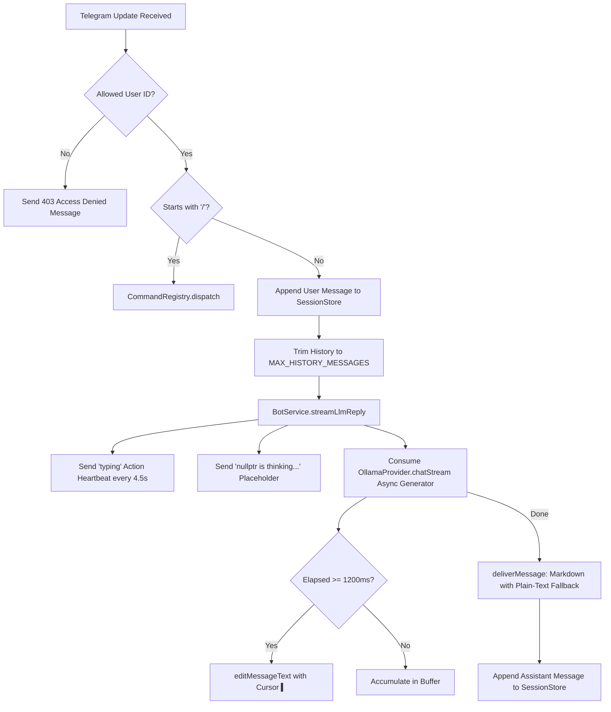

# nullptr (NullPointer Bot) — Streaming & Core Bot Operations

This skill documents the end-to-end operational pipeline of **nullptr (NullPointer Bot)**, including the exact translation of the original single-file `bot.mjs` into our enterprise modular architecture.

---

## 🗺️ Original `bot.mjs` to Modular Architecture Mapping

If you or another LLM need to locate or trace a feature from the original `bot.mjs`, refer to this exact mapping:

| Original `bot.mjs` Component | Modular TypeScript Component | File Path |
|---|---|---|
| `tgRequest()` | `TelegramClient.request()` | `src/domain/telegram/telegram.client.ts` |
| `splitText()`, `sendChunkedMessage()` | `splitMessageText()`, `deliverMessage()` | `src/utils/text.utils.ts` & `src/services/bot.service.ts` |
| `listOllamaModels()` | `OllamaProvider.listModels()` | `src/domain/llm/ollama.provider.ts` |
| `streamOllamaChat()` | `OllamaProvider.chatStream()` + `BotService.streamLlmReply()` | `src/domain/llm/ollama.provider.ts` & `src/services/bot.service.ts` |
| `handleCommand()` | `CommandRegistry.dispatch()` + individual command classes | `src/services/command.registry.ts` & `src/services/commands/` |
| `chatHistory` Map | `InMemorySessionStore` (`ISessionStore`) | `src/domain/session/in-memory-session.store.ts` |
| `processUpdate()` | `BotService.processUpdate()` | `src/services/bot.service.ts` |
| `pollLoop()` | `BotService.start()` | `src/services/bot.service.ts` |
| Top-level environment vars | Centralized `getConfig*()` functions | `src/config/index.ts` |

---

## 🌊 Complete Lifecycle of an Incoming Message

When an update arrives from Telegram via `getUpdates`:



---

## ⚙️ Critical Invariants of the Streaming Engine

### 1. The 1200ms Edit Throttle
- Telegram enforces aggressive rate limits on message editing in private and group chats.
- Never decrease `STREAM_EDIT_INTERVAL_MS` below `1000ms`. The default is `1200ms`.
- If Telegram returns HTTP 429 (`TOO_MANY_REQUESTS`), `BotService` dynamically reads the `retry_after` parameter and delays the next edit accordingly.

### 2. Typing Indicator Heartbeat
- Telegram automatically dismisses the `"typing..."` chat header after 5 seconds.
- While the remote LLM on Oracle Cloud processes the prompt before returning its first token, `BotService` maintains an active heartbeat timer (`setInterval` every 4500ms) to ensure the user knows nullptr is working.
- As soon as the first stream chunk arrives, the heartbeat interval is immediately cleared.

### 3. Cursor Effect
- While streaming, edits append an animated terminal cursor `▍`:
  ```typescript
  const previewText = `${fullContent} ▍`;
  ```
- The final message removes the cursor.

### 4. Resilient Markdown Delivery
- Raw LLM streaming output often contains unclosed markdown tags (e.g. unclosed backticks or asterisks).
- Therefore, intermediate edits are sent without `parse_mode` to prevent Telegram entity parsing errors.
- The final message attempts `parse_mode: "Markdown"`. If Telegram throws an entity parsing error, it automatically falls back to plain text so messages are **never lost**.

### 5. Smart Splitting Over 4000 Characters
- Telegram messages have a strict limit of 4096 characters.
- If the LLM response exceeds 4000 characters:
  1. The existing placeholder is edited to display Chunk 1.
  2. Any remaining chunks are sent sequentially using `sendMessage()`.
  3. Text splitting prioritizes paragraph breaks (`\n\n`), newlines (`\n`), and spaces (` `) to prevent splitting words or code mid-token.

### 6. Context Memory & Model Switch Reset
- Conversation history is trimmed to `MAX_HISTORY_MESSAGES` (default 20) on every turn.
- When a user switches models using `/model <target>`, `ctx.sessionStore.clearHistory(chatId)` is **always called** to prevent context contamination across different model architectures.
